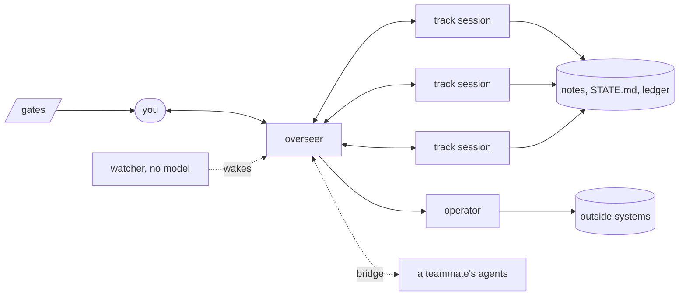

# Genie

Run a fleet of Claude Code sessions that keep working together for days. You
talk to one of them.

Genie is a Claude Code plugin. It gives parallel sessions roles, a memory on
disk, a mailbox, a queue for the few things that need you, and hooks that carry
each session across compactions. It adds no agent runtime. Claude Code supplies
the sessions and the messages between them.



| Role | Job | Rule that makes it work |
|---|---|---|
| Overseer | your one contact. Judges plans, relays, records rulings | never does track work |
| Track | owns one piece of work end to end | one writer per folder |
| Operator | the only session that touches the outside | acts once, reports, never decides |
| Watcher | a script that spots a stuck session | no model calls, exits only to report |
| You | answer gates, set direction | only you can approve |

## Install

Needs Claude Code 2.1.234 or newer (for messages between sessions), Python 3.11
or newer, Git, and on Windows Git Bash.

```bash
claude plugin marketplace add poyrazyongaci/genie
claude plugin install genie@genie
```

To try a local clone without installing: `claude --plugin-dir ./genie`.

Nothing runs until a project opts in. Every hook exits at once in a project
without `.genie/config.json`.

## Start a fleet

1. Open Claude Code in your git repo and type `/genie:init` with what you want
   done. It scaffolds `.genie/`, `notes/` and `tracks/`, and proposes tracks.
2. Open one terminal per session:

   ```bash
   claude --name overseer     # then /genie:overseer
   claude --name api          # then /genie:track api
   claude --name web          # then /genie:track web
   ```

3. Talk to the overseer. Answer what waits on you with `/genie:approve G1` or
   `/genie:deny G1`.

Two tracks are a good first fleet. Each session is a full Claude Code session
and spends tokens like one.

## What is in the box

| Skill | Use |
|---|---|
| `/genie:init` | set up a project |
| `/genie:overseer` | run the hub |
| `/genie:track <slug>` | own a track |
| `/genie:operator` | act outside, on request |
| `/genie:lab <slug>` | run a problem that has a score, see below |
| `/genie:checkpoint` | save state and file what was learned, in one call |
| `/genie:board` | mail between sessions, with receipts |
| `/genie:scout` | 30 minute prior-art search, ranked |
| `/genie:council` | four voices on a hard choice |
| `/genie:santa-loop` | two reviewers must both pass |
| `/genie:second-opinion` | a read-only colleague from another model family |
| `/genie:approve`, `/genie:deny` | answer a gate. Agents cannot run these |
| `/genie:status` | sessions, tracks, labs and gates at a glance |

Three read-only subagents (`reviewer`, `council-voice`, `scout-lane`) and one
command, `genie`, which Claude runs from its Bash tool. `genie help` lists it all.

### Keep-alive

| Problem in a long session | What genie does |
|---|---|
| compaction comes late and loses work | a hook asks for a checkpoint at 72 percent of the window and holds compaction until it exists |
| after compaction the session forgets or stops | a hook gives back the newest `STATE.md` and says carry on |
| a hold could trap a session | it lets go at 96 percent, or after 25 holds |

### Labs

For work with a score. `genie next` derives the stage from files and prints one
job, so any session can continue. The scorer has to earn trust first: it
reproduces known scores, ranks known entries in order, has its noise measured,
and is frozen. A gain under twice the noise is a loss. Try it without spending
a token:

```bash
sh examples/toy-lab/run.sh
```

### Gates

Pushes, submissions, secrets and spending wait in a queue while other work goes
on. The push gate and the rule that only you answer are hooks, not requests to
the model. They guide a cooperative agent. They are not a sandbox, so keep
branch protection and permission rules for hard limits.

## How it compares

| Claude Code feature | Use it for | Genie adds |
|---|---|---|
| Subagents | a side task inside one session | roles for sessions that last |
| Agent teams | one lead that splits a project now | owners that survive compaction and restarts, memory in git, gates |
| `/loop`, scheduled tasks | motion | what to do next, and when a result counts |
| Session messages | a word between sessions | who talks to whom, receipts, teammates on other machines |

## What is proven

Genie comes out of one 48 hour, four-track contest with two people. The
[field report](docs/field-report.md) has the counts and what failed. In short:

| Part | Evidence |
|---|---|
| Overseer, single operator, board | carried 20 hours with few human turns |
| Keep-alive hooks | 64 of 70 compactions it let through had a fresh checkpoint |
| Watcher | replaced a five minute model poll |
| Labs | scorer trust checks ran on real tracks. The keep or revert loop was **not** exercised there: no row was ever kept |
| This plugin | a cleaned-up port. 48 tests. In live sessions a push and a self-approval were refused, and one small session was nudged, held, checkpointed, compacted three times and finished its task. Its window was 100K, so two of the three compactions reached the ceiling before a fresh checkpoint. No long run and no full fleet on it yet |

## What it touches

| Thing | Detail |
|---|---|
| Your repo | `.genie/`, `notes/`, `tracks/`. It never commits |
| `.claude/settings.local.json` | one key, `autoCompactWindow`. Skip it with `genie init --no-window` |
| `~/.claude/genie/` | hook state per session and a compaction log |
| `~/.claude/sessions`, `~/.claude/projects` | read only, to see context size and liveness. These formats are undocumented and may change |
| Network | `genie bridge` pushes one branch, `genie-bridge`. `second-opinion` sends text to that provider. Nothing else |

## Docs

[Method](docs/method.md) · [Architecture and config](docs/architecture.md) ·
[Recipes](docs/recipes.md) · [Troubleshooting](docs/troubleshooting.md) ·
[Field report](docs/field-report.md) · [Contributing](CONTRIBUTING.md)

## License

[MIT](LICENSE). Two skills are adapted from affaan-m/ECC, see
[THIRD_PARTY_NOTICES.md](THIRD_PARTY_NOTICES.md).
